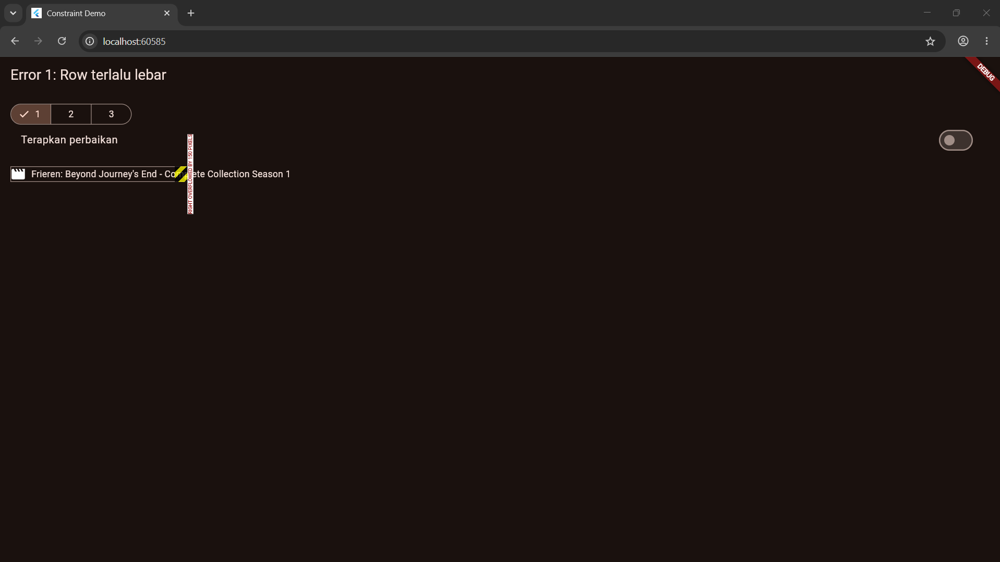
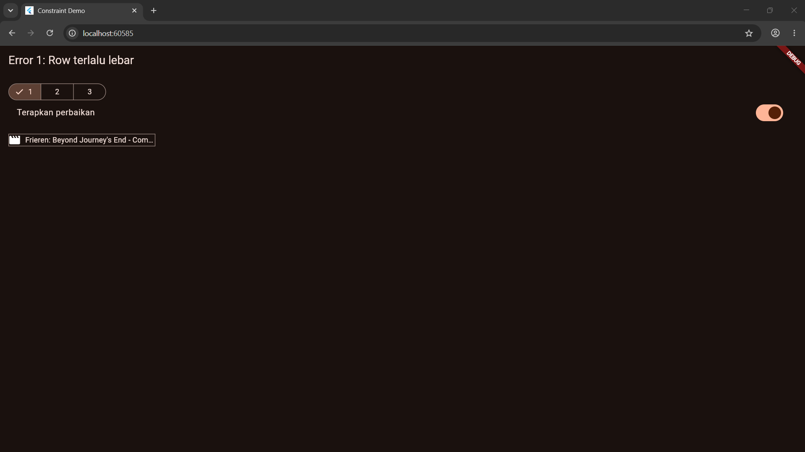
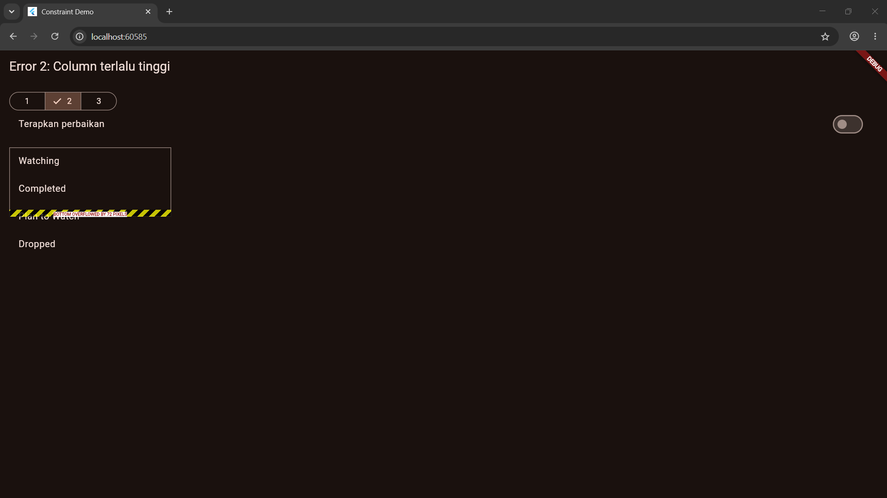
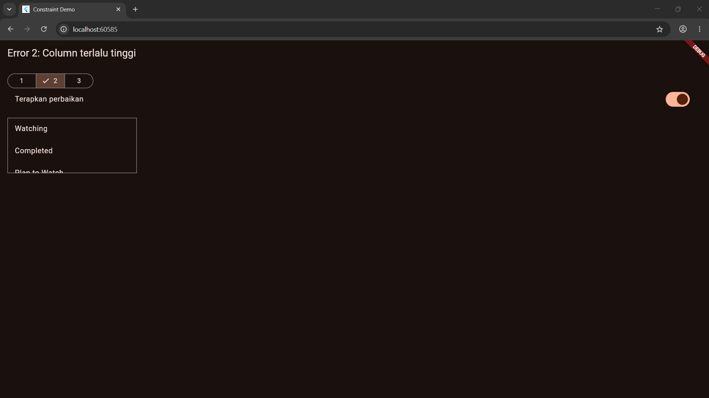
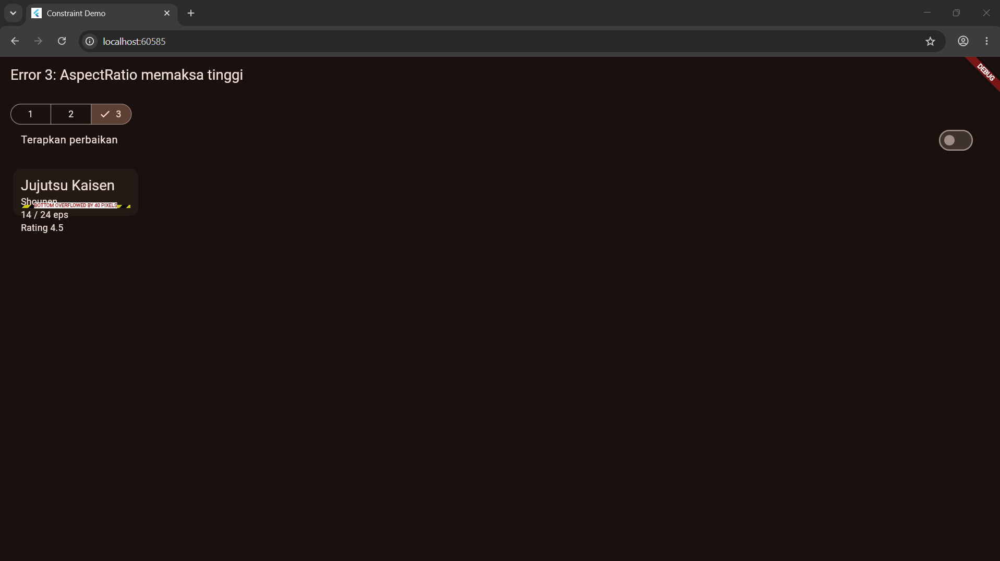
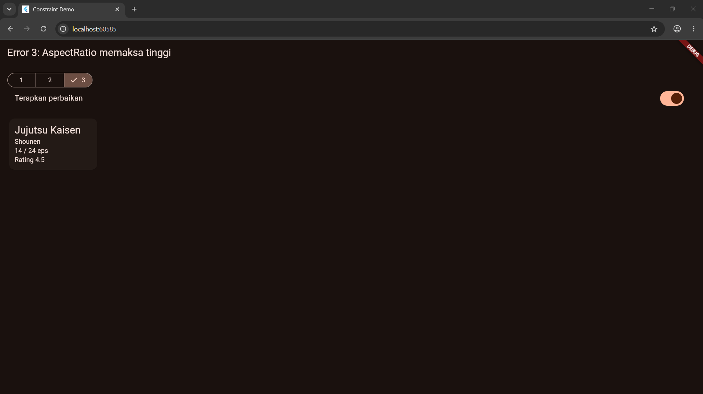

# Constraint Diagnosis — Homework 4

## Error 1: Row terlalu lebar

**Screenshot error:**



**Aturan constraint yang dilanggar:** `Row` memberi anak-anaknya lebar tak terbatas pada sumbu utama, sehingga `Text` tidak pernah diminta mengecil dan lebar totalnya melebihi lebar maksimum yang diberikan parent.

**Kode penyebab:**

```dart
const Row(
  children: [
    Icon(Icons.movie),
    SizedBox(width: 8),
    Text(_text),
  ],
)
```

**Perbaikan:** bungkus `Text` dengan `Expanded` supaya ia hanya mendapat sisa lebar, lalu beri `maxLines` dan `overflow`.

```dart
const Row(
  children: [
    Icon(Icons.movie),
    SizedBox(width: 8),
    Expanded(
      child: Text(
        _text,
        maxLines: 1,
        overflow: TextOverflow.ellipsis,
      ),
    ),
  ],
)
```

**Screenshot setelah perbaikan:**



## Error 2: Column terlalu tinggi

**Screenshot error:**



**Aturan constraint yang dilanggar:** `Column` tidak bisa di-scroll dan tingginya dibatasi maksimum oleh parent (120 dp), sedangkan total tinggi anak-anaknya (4 baris, sekitar 224 dp) melebihi batas itu.

**Kode penyebab:**

```dart
ConstrainedBox(
  constraints: const BoxConstraints(maxWidth: 280, maxHeight: 120),
  child: _tiles, // Column berisi 4 ListTile
)
```

**Perbaikan:** bungkus `Column` dengan `SingleChildScrollView`, sehingga isi yang melebihi batas bisa digeser, bukan dipotong.

```dart
ConstrainedBox(
  constraints: const BoxConstraints(maxWidth: 280, maxHeight: 120),
  child: const SingleChildScrollView(child: _tiles),
)
```

**Screenshot setelah perbaikan:**



## Error 3: AspectRatio memaksa tinggi

**Screenshot error:**



**Aturan constraint yang dilanggar:** `AspectRatio` memberi constraint ketat pada anaknya (tinggi dipaksa dari lebar, 200 / 2.5 = 80 dp), sehingga kartu tidak bisa tumbuh mengikuti isinya yang lebih tinggi.

**Kode penyebab:**

```dart
SizedBox(
  width: 200,
  child: AspectRatio(
    aspectRatio: 2.5,
    child: _card(context, shrink: false),
  ),
)
```

**Perbaikan:** hapus `AspectRatio` dan biarkan isi menentukan tinggi
(`Column` dengan `mainAxisSize: MainAxisSize.min`).

```dart
SizedBox(
  width: 200,
  child: _card(context, shrink: true),
)
```

**Screenshot setelah perbaikan:**

